# Propuesta de desarrollo — App "Ruta"

> **BORRADOR DE TRABAJO · v0.3**
> Documento comercial para presentación al cliente.
> Tipo de cambio de referencia: **12 Bs = 1 USD**.
> *Nombre "Ruta", colores, logotipo y tarifas son **placeholders de ejemplo**; se definen con el cliente.*

| Campo | Detalle |
|---|---|
| Cliente | ________________________________ |
| Proveedor | ________________________________ |
| Fecha | ____ / ____ / 2026 |
| Versión | 0.3 (borrador) |
| Validez de la oferta | 30 días desde la fecha |

---

## 1. Resumen ejecutivo

Proponemos el desarrollo de **"Ruta"**, una aplicación móvil para **Android** que integra dos servicios en una sola plataforma:

1. **Viajes de pasajeros** — solicitud de viajes con conductor, seguimiento en tiempo real y calificación.
2. **Mandados** — un repartidor compra y entrega productos por encargo del cliente (lista de compras + compra física + entrega).

El sistema se compone de **tres frentes**: la app del **pasajero**, la app del **conductor/repartidor** y un **panel web de administración**. Está pensado para operar en ciudades donde el servicio aún no llega, con una base inicial de aproximadamente **1.000 usuarios**.

El pago se realiza **en efectivo** (el pasajero entrega el dinero directamente al conductor/repartidor), lo que **elimina comisiones de pasarelas de pago** en esta primera etapa.

La **tarifa** de cada viaje combina el **recorrido por kilómetro**, el **tiempo estimado** y un cargo fijo por **uso de la app (Bs 6)**, con **tarifas dinámicas** por lluvia y horas pico. La plataforma cobra una **comisión porcentual** (configurable, por defecto **10 %**) del total del viaje, que se **descuenta del crédito** del conductor. Cuando el saldo baja, el conductor **solicita una recarga** desde la app, paga en efectivo al administrador y este **acredita el monto** desde el panel (generando una tarea de aprobación).

**Inversión de desarrollo: Bs 15.000** (pago único).

---

## 2. Presentación del sistema

A continuación se muestra el recorrido del usuario. Las imágenes son **mockups** de las pantallas reales del sistema.

### 2.1 App de pasajeros

| Registro e ingreso | Inicio y elección de servicio |
|---|---|
| 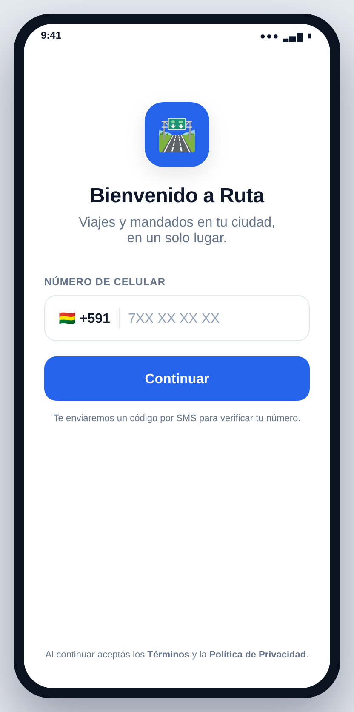 | 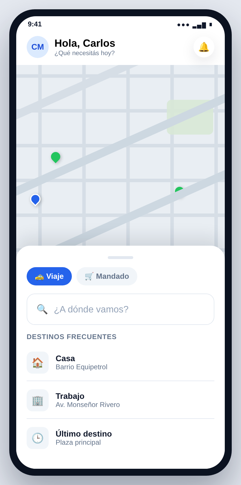 |
| Ingreso con número de celular verificado por **SMS (OTP)**. | Mapa, destinos frecuentes y selector **Viaje / Mandado**. |

| Solicitar viaje | Seguimiento en vivo |
|---|---|
| 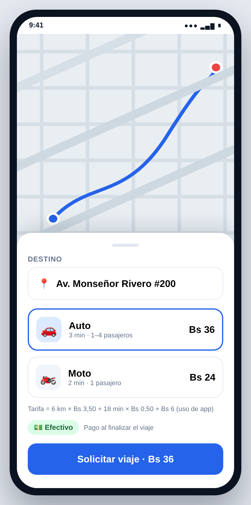 | 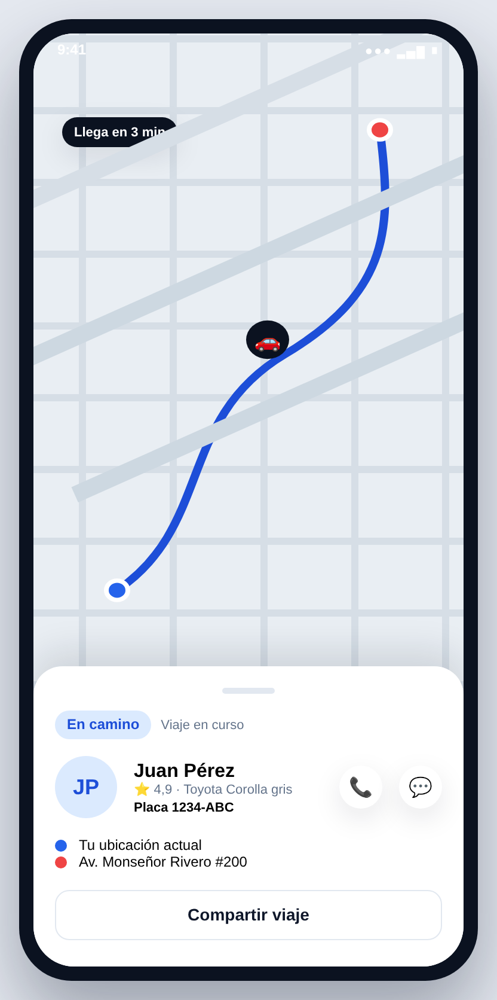 |
| Elección de destino, tipo de vehículo (Auto / Moto) y **tarifa estimada**. | Ubicación del conductor en tiempo real, datos del vehículo y contacto. |

| Pago y calificación |
|---|
| 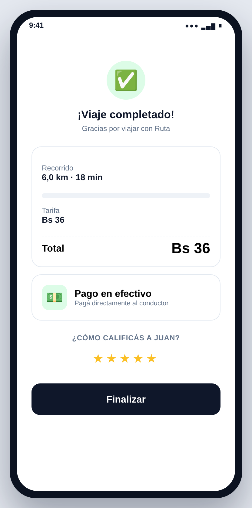 |
| Resumen del viaje, **pago en efectivo** y calificación del conductor. |

### 2.2 App de conductores

| Panel del conductor | Nueva solicitud |
|---|---|
| 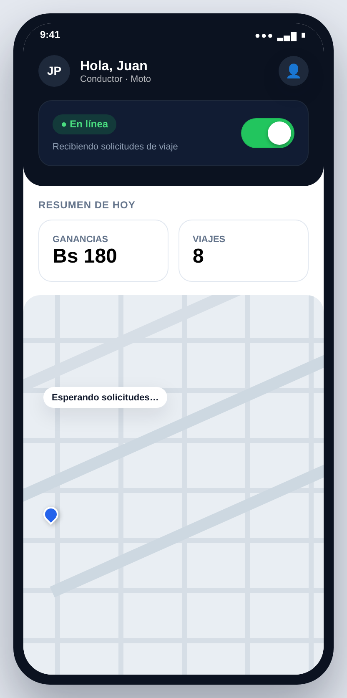 | 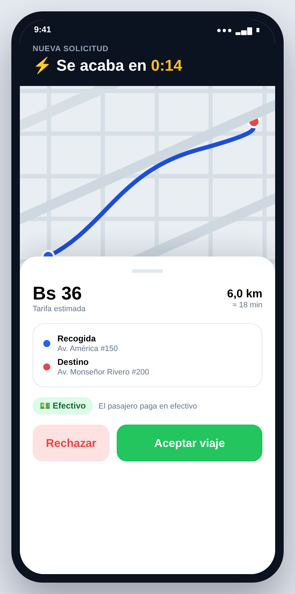 |
| Estado **En línea / Desconectado**, ganancias y viajes del día. | Recepción de solicitudes con origen, destino, distancia y tarifa; aceptar o rechazar. |

### 2.3 Módulo de mandados

| Nuevo mandado | Seguimiento del mandado |
|---|---|
| 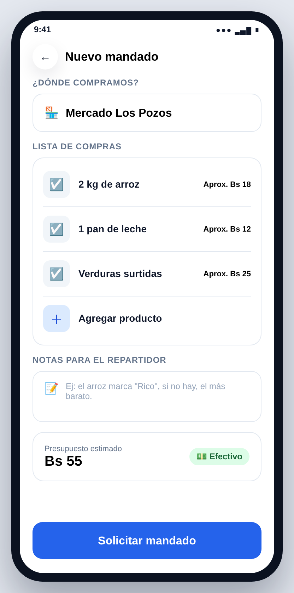 | 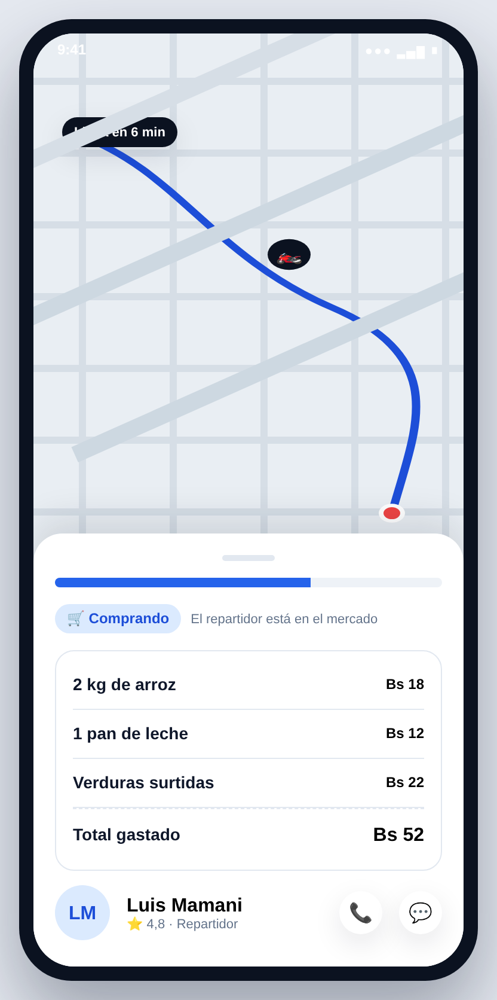 |
| Lista de compras, tienda, notas para el repartidor y presupuesto estimado. | Estado de compra, detalle de gastos, total y ubicación del repartidor. |

### 2.4 Panel de administración (web)

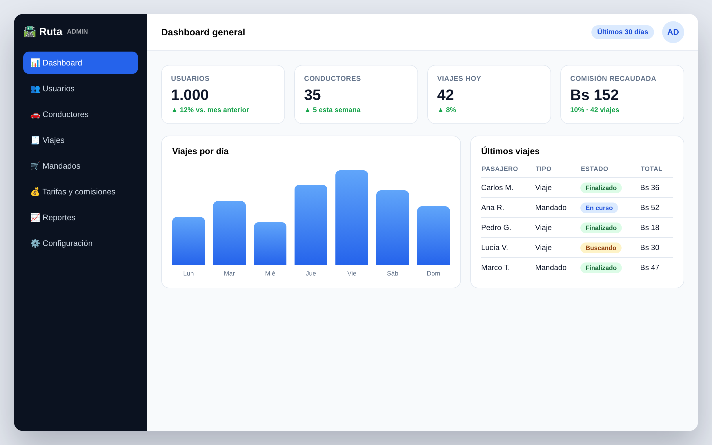

Gestión de usuarios, conductores, viajes, mandados, tarifas/comisiones, reportes e indicadores del negocio.

### 2.5 Crédito del conductor y comisiones

| Crédito del conductor (app) | Crédito y recargas (admin) |
|---|---|
| 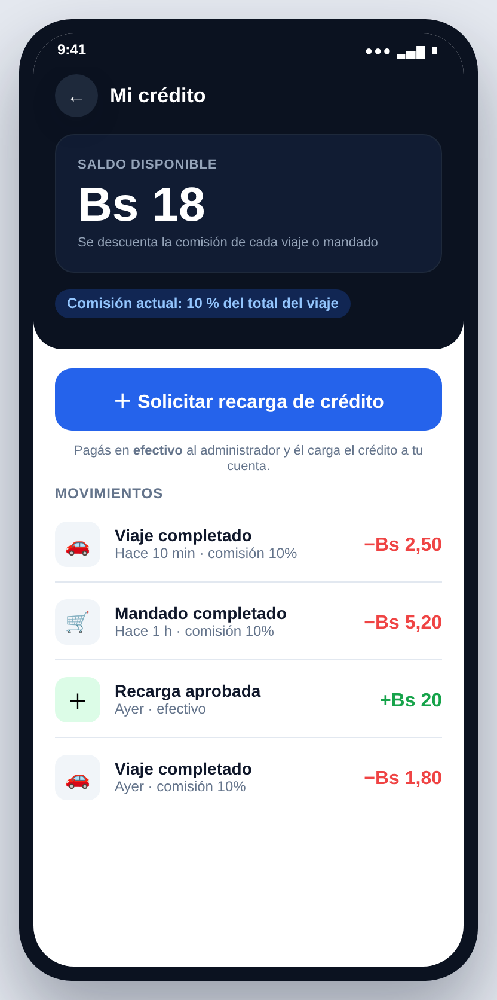 | 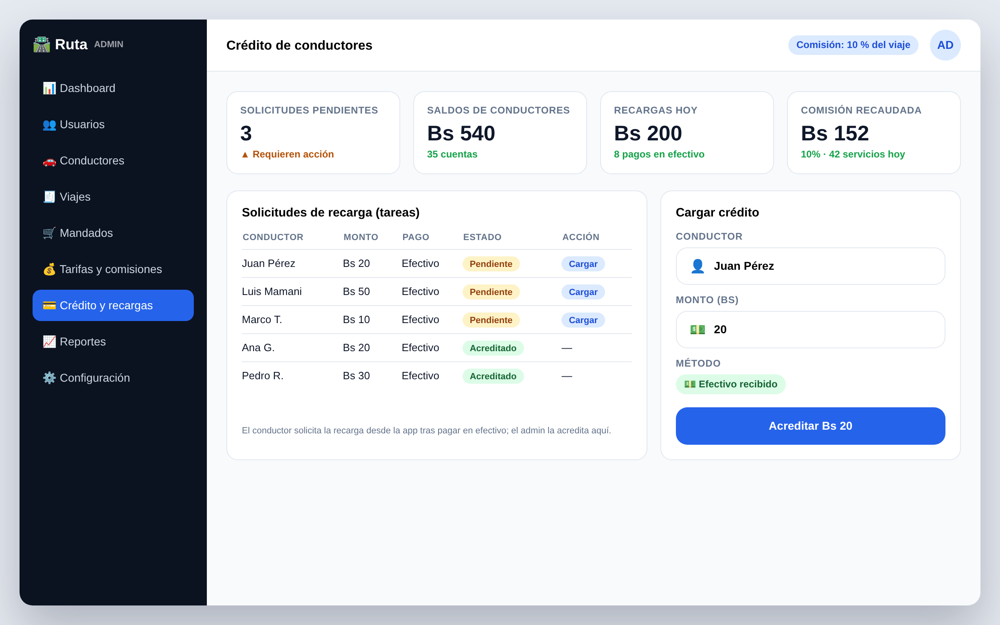 |
| Saldo disponible, comisión vigente, movimientos y botón para **solicitar recarga**. | Lista de **solicitudes de recarga (tareas)** y formulario para **acreditar crédito**. |

**Cómo funciona el crédito**

```
   CONDUCTOR                         ADMINISTRADOR
   ┌──────────────┐                  ┌──────────────┐
   │ Completa     │  comisión (%)    │              │
   │ viaje/mandado│ ───────────────▶ │  (comisión)  │
   └──────┬───────┘                  └──────────────┘
          │ saldo bajo
          ▼
   ┌──────────────┐   paga efectivo  ┌──────────────────────┐
   │ Solicita     │ ───────────────▶ │ Recibe el pago y crea│
   │ recarga      │                  │ la tarea de recarga  │
   └──────────────┘                  └──────────┬───────────┘
                                                 │ acredita
                                                 ▼
                                        ┌──────────────────┐
                                        │ Saldo del        │
                                        │ conductor +Bs N  │
                                        └──────────────────┘
```

1. El conductor completa un viaje o mandado → se **descuenta la comisión (%)** de su crédito.
2. Si el saldo es bajo, **solicita recarga** desde la app.
3. El conductor **paga en efectivo** al administrador (contacto por la plataforma).
4. El administrador **acredita el monto** desde el panel (tarea de recarga).
5. El saldo actualizado se refleja en la app del conductor.

> La comisión es un **porcentaje configurable** por el administrador (por defecto **10 %** del total del viaje).

### 2.6 Tarifas y comisiones (configuración)

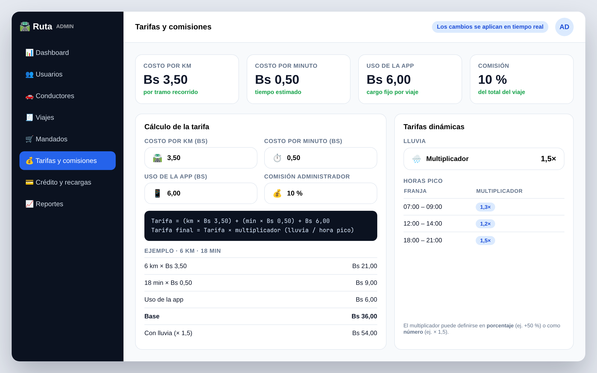

El administrador configura los **costos de la tarifa** (por km, por minuto y uso de la app), el **porcentaje de comisión** y los **multiplicadores dinámicos** por **lluvia** y **horas pico** (en porcentaje o como número). La fórmula de cálculo se detalla en la **sección 11**.

---

## 3. Funcionalidades por perfil

**Pasajero**
- Registro/ingreso con celular y verificación por SMS.
- Mapa con ubicación en tiempo real, origen y destino.
- Tarifa estimada según **tramo por km + tiempo + uso de la app**, con multiplicadores por **lluvia / hora pico**.
- Solicitud de viaje y asignación de conductor.
- Seguimiento en vivo y datos del conductor.
- Historial de viajes y calificación.
- Módulo de **mandados**: lista de compras, presupuesto y seguimiento.

**Conductor / Repartidor**
- Registro con documentos (licencia, SOAT, papeles del vehículo).
- Estado En línea / Desconectado.
- Recepción de solicitudes (aceptar / rechazar).
- Navegación al punto de recogida y destino.
- Registro de ganancias e historial.
- **Crédito**: saldo, movimientos y solicitud de recarga (se descuenta Bs 1 por servicio).

**Administrador (web)**
- Alta/baja de usuarios y conductores.
- Configuración de **tarifas** (por km, por minuto, uso de la app), **comisión %** y **multiplicadores dinámicos** (lluvia, horas pico).
- **Gestión de crédito**: aprobar solicitudes de recarga (tareas) y acreditar saldo a conductores.
- Supervisión de viajes y mandados en tiempo real.
- Reportes e indicadores (viajes, ingresos, usuarios activos).
- Soporte y gestión de incidencias.

---

## 4. Arquitectura y stack técnico

```
                         ┌───────────────────────────┐
                         │      BACKEND / API        │
                         │  (VPS · REST + WebSocket) │
                         └────────────┬──────────────┘
              ┌───────────────────────┼───────────────────────┐
              │                       │                       │
     ┌────────▼────────┐     ┌────────▼────────┐     ┌────────▼─────────┐
     │  APP PASAJERO   │     │  APP CONDUCTOR  │     │  PANEL ADMIN WEB │
     │    (Android)    │     │    (Android)    │     │    (Navegador)   │
     └─────────────────┘     └─────────────────┘     └──────────────────┘
              │                       │                       │
              └───────────┬───────────┴───────────┬───────────┘
                          │                       │
                 ┌────────▼────────┐     ┌────────▼─────────┐
                 │  Base de datos  │     │  Servicios       │
                 │  (PostgreSQL /  │     │  - Google Maps   │
                 │   PostGIS)      │     │  - SMS/OTP       │
                 └─────────────────┘     │  - Push (FCM)    │
                                          └──────────────────┘
```

| Capa | Tecnología propuesta |
|---|---|
| Apps móviles | Android nativo o React Native (a definir) |
| Backend | API REST + WebSocket (tiempo real) |
| Base de datos | PostgreSQL (con extensión geoespacial) |
| Mapas | **Google Maps Platform** |
| Notificaciones | Firebase Cloud Messaging (FCM) |
| Verificación | SMS/OTP |
| Infraestructura | **VPS** (ver sección 8.2) |

> El stack definitivo se confirma en la fase de arranque; lo propuesto prioriza costo y escalabilidad.

---

## 5. Alcance

**INCLUYE**
- App Android para pasajeros.
- App Android para conductores/repartidores.
- Panel web de administración.
- Módulo de viajes y módulo de mandados.
- Pago en efectivo y calificaciones.
- **Sistema de crédito del conductor**: comisión por servicio (Bs 1) y solicitudes de recarga aprobadas por el admin.
- Verificación por SMS, notificaciones push y mapas integrados.
- Configuración y publicación inicial en Google Play Store.
- Capacitación básica de uso del panel.

**NO INCLUYE** (se cotiza aparte)
- App para iOS (Apple).
- Pasarela de pago / cobros con tarjeta o QR.
- Diseño de identidad de marca (logo, colores, manual).
- Hardware (celulares, servidores físicos).
- Costos recurrentes de servicios (Google Maps, SMS, VPS, dominio) — ver sección 8.
- Cambios fuera del alcance definido, una vez aprobado.

---

## 6. Cronograma por fases

| Fase | Contenido | Duración estimada |
|---|---|---|
| 1. Análisis y diseño | Requerimientos, flujos, prototipo UI | 1–2 semanas |
| 2. Backend y base de datos | API, autenticación, geolocalización | 2–3 semanas |
| 3. App pasajero | Registro, viajes, mandados, pagos | 3–4 semanas |
| 4. App conductor | Solicitudes, navegación, ganancias | 2–3 semanas |
| 5. Panel admin | Gestión, tarifas, reportes | 1–2 semanas |
| 6. Pruebas y publicación | QA, pruebas en Play (testers), lanzamiento | 1–2 semanas |
| **Total estimado** | | **10–16 semanas** |

> Nota: Google exige que las cuentas nuevas realicen **pruebas cerradas con 12 usuarios durante 14 días** antes de publicar en producción. Está contemplado en la fase 6.

---

## 7. Entregables

1. Apps Android (pasajero + conductor) publicadas en Google Play Store.
2. Panel de administración web desplegado y funcional.
3. Código fuente del proyecto.
4. Base de datos configurada y respaldos.
5. Documentación de uso (panel admin) y capacitación básica.
6. Cuentas y accesos configurados (a nombre del cliente).

---

## 8. Presupuesto

> Tipo de cambio de referencia: **12 Bs = 1 USD**.

### 8.1 Costos únicos (una sola vez)

| Concepto | USD | Bs |
|---|---:|---:|
| **Desarrollo** (viajes + mandados + panel admin) | 1.250 | **15.000** |
| Registro Google Play Console (pago único) | 25 | 300 |
| Dominio `.com` (1 año) | 12 | 144 |
| Diseño de logo / identidad de marca *(opcional)* | a definir | a definir |
| **Subtotal base** | **1.287** | **15.444** |

### 8.2 Costos recurrentes (mensuales / anuales)

| Concepto | USD/mes | Bs/mes |
|---|---:|---:|
| VPS Hostinger **KVM 4** (São Paulo, Brasil) — precio promocional 24 meses | 12,99 | 156 |
| *(mismo VPS, precio de renovación)* | 28,99 | 348 |
| Google Maps Platform (con cupos gratis; varía según uso) | 0 – 40 | 0 – 480 |
| SMS / verificación OTP | ~10 | ~120 |
| Dominio (prorrateado) | ~1 | ~12 |
| Notificaciones push (Firebase FCM) | 0 | 0 |
| **Total estimado mensual (año 1)** | **~24 – 92** | **~290 – 960** |

> **Google Maps:** desde marzo 2025 otorga **cupos gratuitos por servicio y por mes** (p. ej. 10.000 llamadas/mes en categoría *Essentials*). Con 1.000 usuarios el costo suele ser **bajo o nulo** al inicio, y crece con el uso.

### 8.3 Resumen y cotización

| | Bs |
|---|---:|
| Inversión de desarrollo (única) | **15.000** |
| Costos únicos de puesta en marcha (Play + dominio) | 444 |
| Costos operativos estimados, primer año | 3.500 – 11.500 |
| **Total estimado primer año** | **~19.000 – 27.000** |

**Cotización de desarrollo: Bs 15.000** (cubre el alcance de la sección 5).

### 8.4 Gastos que debe cubrir el cliente

- Cuenta y verificación de Google Play Console.
- Dominio y su renovación anual.
- Servidor VPS y su mantenimiento mensual.
- Consumo de Google Maps, SMS y demás servicios de terceros.
- *(Si se quiere iOS en el futuro)* Apple Developer: **$99/año**.

---

## 9. Requisitos del cliente

Para iniciar y publicar el sistema, el cliente debe proveer:

- Cuenta de Google (Gmail) para publicar en Play Store.
- Datos de la empresa/institución (si la cuenta de Play será de organización, se requiere verificación legal y **D-U-NIS**).
- Dominio y acceso a DNS.
- Documentos de los conductores (licencia, SOAT, papeles del vehículo).
- Logo y definición de marca (si no se contrata diseño).
- Tarifas y reglas de comisión.
- Datos de contacto de soporte y textos legales (términos y privacidad).
- **Método de pago:** en esta etapa, efectivo.

---

## 10. Soporte y mantenimiento

El soporte y mantenimiento se cotiza **por requerimiento**, según el **esfuerzo** que demande la corrección, el cambio o el arreglo de un bug:

| Tipo de requerimiento | Descripción | Rango (Bs) |
|---|---|---:|
| **De forma** | Cambios superficiales: textos, colores, íconos, ajustes de interfaz, correcciones menores de presentación. | **500 – 2.000** |
| **De fondo** | Cambios de lógica o funcionamiento: reglas de negocio existentes, bugs complejos, ajustes estructurales. | **2.500 – 5.000** |
| **Modelo de negocio / funcionalidades nuevas** | Cambios de modelo de negocio o **nuevas funcionalidades**. | Sujeto a **análisis y presupuesto** |

> Cada requerimiento se **evalúa por su esfuerzo** y se **presupuesta antes de ejecutarlo**. Los rangos aplican por requerimiento/incidencia. El soporte y mantenimiento **no están incluidos** en la inversión de desarrollo.

---

## 11. Modelo de negocio

### 11.1 Cálculo de la tarifa

La tarifa de cada viaje se calcula sumando el **tramo por kilómetro**, el **tiempo estimado** y un **cargo fijo por uso de la aplicación**:

```
Tarifa = (km recorridos × costo por km)
       + (tiempo estimado × costo por minuto)
       + Bs 6,00 (uso de la aplicación)

Tarifa final = Tarifa × multiplicador dinámico (lluvia / hora pico)
```

Valores por defecto (**configurables por el administrador**):

| Concepto | Valor |
|---|---:|
| Costo por km (tramo) | Bs 3,50 |
| Costo por minuto | Bs 0,50 |
| Uso de la aplicación | Bs 6,00 |

### 11.2 Comisión

La comisión es un **porcentaje del total del viaje** (ya no un monto fijo), definido por el administrador:

- **Comisión por defecto: 10 %** del total del viaje o mandado.
- Se **descuenta del crédito** del conductor al completar el servicio.

### 11.3 Tarifas dinámicas

El administrador define **multiplicadores** que se aplican a la tarifa final:

- **Lluvia:** multiplicador activable (ej. × 1,5).
- **Horas pico:** franjas horarias con su multiplicador (ej. 07:00–09:00 × 1,3; 18:00–21:00 × 1,5).

El multiplicador puede definirse en **porcentaje** (ej. +50 %) o como **número** (ej. × 1,5).

### 11.4 Crédito del conductor

- El conductor mantiene un **saldo de crédito** en la app.
- De allí se **descuenta la comisión** de cada servicio.
- El conductor **recarga** su crédito pagando **en efectivo** al administrador, quien acredita el monto desde el panel mediante una **tarea de recarga**.

Este esquema permite **cobrar la comisión sin pasarela de pago**, adaptándose a la operación en efectivo de la región. *(Proyección de ingresos a definir con el cliente.)*

---

## 12. Términos comerciales

- **Forma de pago:** **Bs 2.000 cada 15 días** durante el desarrollo, hasta finalizar el proyecto. El **saldo restante** se cancela al **finalizar y entregar** la aplicación.

  | Pago | Momento | Monto (Bs) |
  |---|---|---:|
  | 1 | Al inicio | 2.000 |
  | 2 | Día 15 | 2.000 |
  | 3 | Día 30 | 2.000 |
  | 4 | Día 45 | 2.000 |
  | 5 | Día 60 | 2.000 |
  | 6 | Día 75 | 2.000 |
  | 7 | Día 90 | 2.000 |
  | **Final** | Entrega del proyecto | **1.000** |
  | | **Total** | **15.000** |
- Los costos únicos y recurrentes (sección 8) se abonan por separado.
- **Propiedad del código fuente:** se transfiere al cliente al liquidar el pago total.
- Cambios de alcance se cotizan por separado.
- La validez de esta oferta es de **30 días**.

---

## 13. Legal mínimo (obligatorio para Play Store)

- **Política de privacidad** (la exige Google para publicar).
- **Términos y condiciones** de uso.
- Tratamiento de datos personales de usuarios y conductores.
- Registro/constitución legal del negocio para las cuentas y facturación.

---

## 14. Escalabilidad

El sistema parte con una arquitectura dimensionada para **~1.000 usuarios**. El VPS y la base de datos pueden **escalar verticalmente** (más recursos) al crecer, sin reescribir el sistema. Si el volumen crece mucho, se puede migrar a una arquitectura distribuida (varios servidores, servicios gestionados).

---

## 15. Aceptación

| | Cliente | Proveedor |
|---|---|---|
| Nombre | ________________ | ________________ |
| Firma | ________________ | ________________ |
| Fecha | ____ / ____ / 2026 | ____ / ____ / 2026 |

---

<!--
NOTA INTERNA (no mostrar al cliente)
- Las capturas se generan desde mockups/ con ./render.sh (requiere chromium).
- Editar el branding en mockups/_base.css (--brand, nombre, emojis/íconos).
- Reemplazar los placeholders: nombre "Ruta", montos de ejemplo.
- Tarifa por defecto: Bs 3,50/km + Bs 0,50/min + Bs 6 uso de app (configurable por el admin).
- Comisión: porcentaje del total del viaje (por defecto 10%); confirmar valor con el cliente.
- Tarifas dinámicas: multiplicadores por lluvia y horas pico (% o número).
- Flujo de recarga: solicitud desde la app + tarea de aprobación en el admin.
- Completar los valores "a definir": branding, opciones de negocio.
-->
